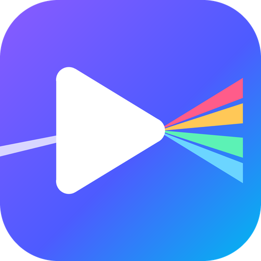
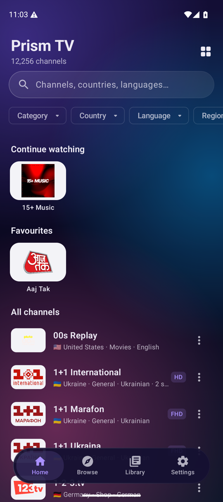
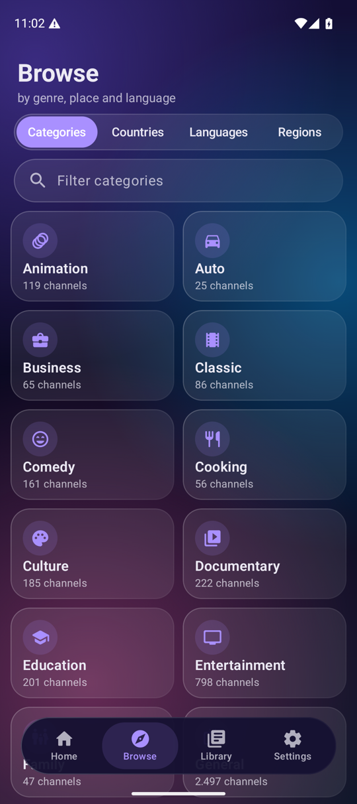
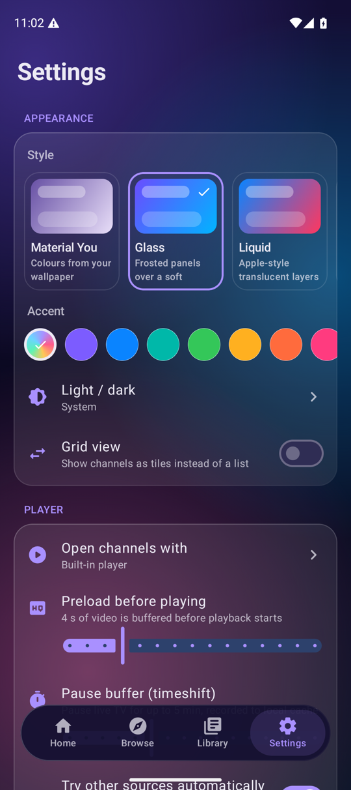
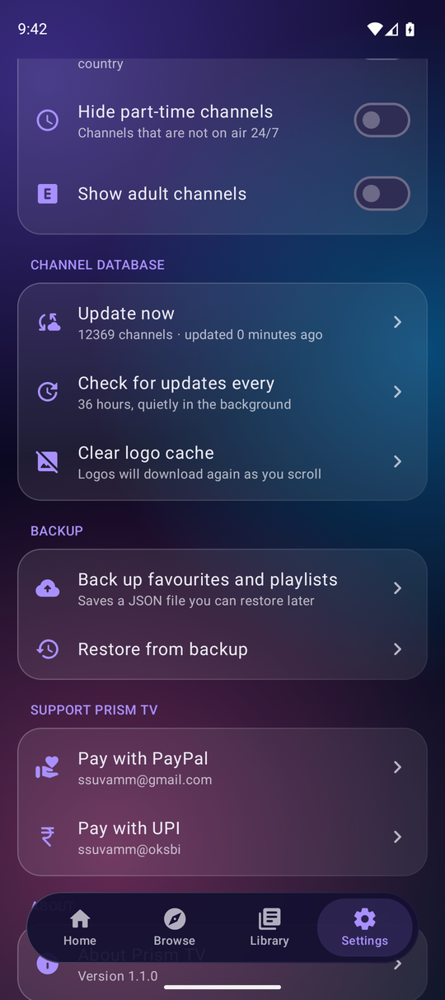

<p align="center">
  
</p>

<h1 align="center">Prism TV</h1>

<p align="center">
  A fast, good-looking Android player for the thousands of free TV channels listed by
  <a href="https://github.com/iptv-org/iptv">iptv-org</a>.
</p>

<p align="center">
  <a href="../../releases/latest"></a>
  <a href="../../actions/workflows/build.yml"></a>
  <a href="LICENSE"></a>
</p>

---

I wanted something that felt like a proper TV app rather than a playlist viewer: open it, find a
channel in a couple of taps, and have it start playing without the list jumping around behind you.
Prism TV pulls the public iptv-org database, keeps a compact copy on the phone, and plays streams in
a built-in Media3 player (or hands them to VLC if you prefer).

<p align="center">
  
  
  
  
</p>

## Features

**Finding channels**
- Around 12,000 channels with proper names, logos, country flags, languages and genres
- One search box that matches names, alternative names, networks, countries, languages and categories
- Filters for category, country, language, region and minimum quality, plus sorting
- Browse tab that groups everything by category, country, language or region, with counts
- Channels with several feeds or qualities are merged into one entry, with all sources available

**Your stuff**
- Favourites, watch history and as many playlists as you like
- Long-press any channel: play, play in VLC, open with another app, pick a source, add to favourites or a playlist, hide, copy or share the link
- Hidden channels live in Settings, where you can bring them back
- Import M3U playlists from a file or URL, export your playlists as M3U
- Add your own stream links to any playlist
- Back up and restore everything as a single JSON file

**Playback**
- Built-in player based on AndroidX Media3 (HLS, DASH and progressive streams)
- Waits for a configurable preload buffer before starting (8 seconds by default) so playback doesn't stutter
- Pause live TV for up to 5 minutes (configurable). While paused, the stream is recorded to the
  app cache, and resuming carries on exactly where you stopped. A "Go live" button jumps back to the broadcast
- Swipe up and down on the left half for brightness, on the right half for volume
- Live TV keeps the controls simple: play/pause only. Once you pause, 10 second back/forward buttons,
  double-tap seeking and a seek bar appear for moving around the recorded buffer
- Pinch to switch between fit and crop, lock button to ignore touches
- A slide-in channel list for switching channels, picture-in-picture, sleep timer
- Quality, audio track, subtitle and source buttons right in the player bar (audio and subtitles show up
  when the stream actually has more than one option), plus a stream info panel
- If a stream fails it tries the channel's other sources automatically
- Open the current stream in VLC, MX Player or any other app, straight from the player
- Custom User-Agent and Referer headers are sent for streams that need them
- Built for remotes too: every screen can be driven with a D-pad, OK brings up the player controls,
  Back hides them, left/right skip while paused, the Menu key opens a channel's options

**Under the hood**
- All network traffic (database, logos and the streams themselves) resolves through DNS over HTTPS.
  Cloudflare 1.1.1.1 is the default; Cloudflare's malware and family filters, Google, Quad9 or your system DNS are one tap away
- The channel database refreshes quietly every 36 hours (configurable). The download runs at low priority and the
  new data is only swapped in while the app is in the background, so nothing ever changes under your finger
- Favourites and playlists survive database updates. If a channel's id changes upstream, it is matched again by name
- The catalog is stored in a small binary file that loads in a fraction of a second, and lists are keyed by channel,
  so coming back from the player leaves you exactly where you were

**Looks**
- Six styles: Material You (wallpaper colours), Glass, Liquid (an Apple-style translucent look), AMOLED black, Neon and Sunset
- Light, dark or follow the system, with an optional accent colour
- List or grid layout

## Download

Grab the latest `PrismTV-x.y.z-universal.apk` from the [releases page](../../releases/latest). It is a single
APK for every phone, tablet and TV running Android 6.0 or newer.

### TVs

Prism TV runs on Android TV and Google TV (Sony, TCL, Hisense, Philips, Xiaomi, Chromecast with Google TV,
Nvidia Shield), Amazon Fire TV, Fire TV Stick and Fire TV Cube, and Android TV boxes running Android 6.0 or newer.
It shows up in the TV launcher with its own banner, opens in a tile layout, and works entirely with the remote.
On Android 6 and 7.0 it bundles the Let's Encrypt root certificates, so HTTPS streams that would otherwise fail
on those devices still play.

On Amazon devices that covers everything from Fire OS 6 onwards (Fire TV Stick 4K from 2018 and later, every
Fire TV Cube, Stick Lite, 3rd gen Stick, 4K Max). The original 2014 to 2017 Fire TV models run Fire OS 5
(Android 5.1) and aren't supported. The newest Fire TV Stick 4K Select runs Amazon's Vega OS, which is not
Android-based and can't install Android apps.

To install on a TV, sideload the APK (for example with the "Downloader" app on Fire TV, or "Send Files to TV"
on Android TV).

Samsung (Tizen), LG (webOS), Roku and Apple TV run their own operating systems and can't install Android apps.
On those, plug in a Fire TV Stick or Chromecast with Google TV.

## Building it yourself

You need JDK 17 and the Android SDK (platform 37). Then:

```sh
./gradlew assembleDebug      # app/build/outputs/apk/debug/
./gradlew assembleRelease    # app/build/outputs/apk/release/
```

Release builds are minified with R8. Without a signing key they are signed with the debug key, which is fine for
trying things out. See [docs/RELEASING.md](docs/RELEASING.md) for signing and publishing.

## How it's put together

```
app/src/main/java/io/github/prismtv/
  data/catalog/   downloads the iptv-org API, merges it into channels, binary cache, refresh policy
  data/user/      favourites, hidden channels, playlists, history and settings (one JSON file)
  data/sync/      WorkManager job for the periodic refresh
  net/            OkHttp client with DNS over HTTPS
  player/         player activity, Compose controls and gestures, timeshift recorder, external players
  ui/             Compose screens, navigation, themes
```

A few notes for anyone digging in:

- **Data source.** The app reads the JSON files from [iptv-org/api](https://github.com/iptv-org/api)
  (`channels`, `streams`, `feeds`, `logos`, `countries`, `languages`, `categories`, `regions`, `blocklist`), which
  are generated from the iptv-org repository. Streams are grouped by channel, languages come from the feeds,
  and anything on the blocklist is dropped.
- **Timeshift.** When you pause an HLS stream, `TimeshiftRecorder` keeps downloading the media playlist's segments
  into the cache folder and writes a local sliding-window playlist. On resume the player switches to that local
  playlist at the exact paused position. Segments older than the configured window are deleted as new ones arrive.
  Short pauses are covered by the normal in-memory buffer. DRM-protected streams are not recorded.
- **Refresh.** `CatalogRepository` checks the age of the local copy at launch and whenever the app comes to the
  foreground. A refresh that finishes while you are using the app is held back until the app is in the background.

## Support the project

Prism TV is free, has no ads and never will. If it's useful to you and you'd like to say thanks, you can
chip in here. It's also in the app under **Settings > Support Prism TV**.

| | |
| --- | --- |
| **PayPal** | [](https://www.paypal.com/cgi-bin/webscr?cmd=_xclick&business=ssuvamm%40gmail.com&item_name=Support+Prism+TV&currency_code=USD) &nbsp; `ssuvamm@gmail.com` |
| **UPI** (India) | `ssuvamm@oksbi`, works with Google Pay, PhonePe, Paytm, BHIM and any other UPI app |

<p align="center">
  
  <br><sub>Scan with any UPI app</sub>
</p>

## Contributing

Bug reports and pull requests are welcome. Please read [CONTRIBUTING.md](CONTRIBUTING.md) first.

If a particular channel is broken, missing or mislabelled, that is almost always something to fix in the
[iptv-org/iptv](https://github.com/iptv-org/iptv) database rather than in this app.

## Legal

Prism TV does not host, provide or control any video content. It plays publicly available streams listed by the
iptv-org community, and every stream belongs to its broadcaster. Some channels may not be available in your country.
If you believe a stream should not be listed, please contact iptv-org.

The app is released under the [MIT License](LICENSE). The channel data comes from iptv-org, which is released into
the public domain (Unlicense / CC0). Third-party libraries keep their own licences (Apache 2.0 for AndroidX, Media3,
OkHttp and Coil).
